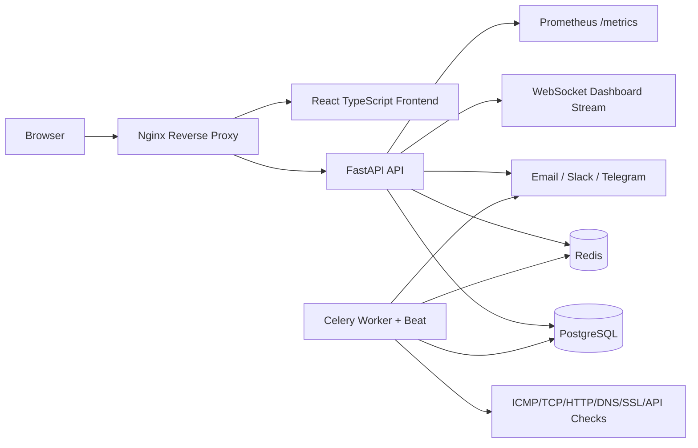

# System Architecture



## Core Design

- **Multi-tenant by organization:** tenant-owned tables include `organization_id` and are accessed through tenant-scoped repositories.
- **Clean architecture:** API routes delegate to services; services use repositories and domain models.
- **Real time:** WebSocket endpoint streams dashboard summary updates to authenticated clients.
- **Async monitoring:** Celery beat schedules checks and workers persist metrics/incidents.
- **Security:** JWT auth, role checks, hashed passwords, CORS allowlist, tenant isolation, audit-log model.
- **Operational readiness:** Docker Compose, Nginx reverse proxy, Prometheus metrics endpoint, structured JSON logging.

## Folder Structure

```text
NetPulse/
  backend/
    app/
      api/              FastAPI dependencies and versioned routes
      core/             config, logging, security
      db/               SQLAlchemy engine/session
      domain/           SQLAlchemy models and Pydantic schemas
      repositories/     tenant-scoped data access
      services/         auth, monitoring, alerting business logic
      workers/          Celery app and scheduled tasks
    tests/
  frontend/
    src/
      components/       shared UI components
      pages/            page-level views
      services/         API/WebSocket clients
      types/            TypeScript DTOs
  infra/nginx/          reverse proxy
  deploy/aws/           EC2 bootstrap script
  docs/                 architecture, API, deployment, tests
```
